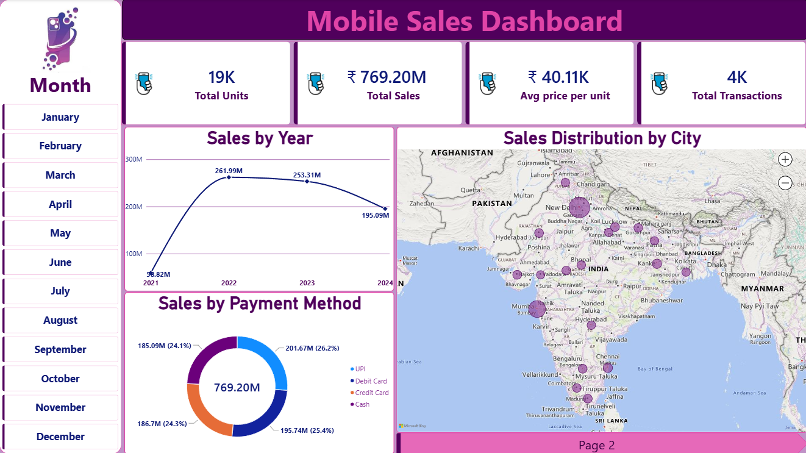
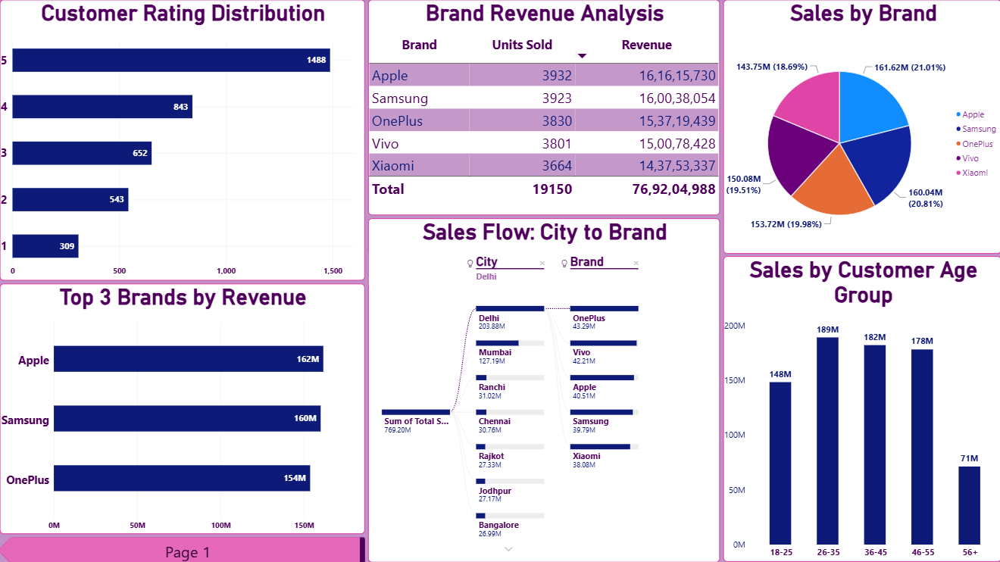

# 📱 Mobile Sales Dashboard

An interactive **Mobile Sales Dashboard** built using Microsoft Power BI to analyze sales performance, brand revenue, customer behavior, and purchasing patterns through data visualization and business intelligence.

## 📊 Project Overview

This project focuses on analyzing mobile sales data to understand business performance and customer purchasing behavior. The dashboard provides interactive insights into sales trends, brand performance, customer ratings, payment preferences, and customer age groups.

The dashboard consists of two report pages:

- **Page 1 – Sales Overview:** Provides a summary of overall sales performance, yearly sales trends, city-wise sales distribution, and payment methods.
- **Page 2 – Product & Customer Analysis:** Focuses on brand revenue, customer ratings, city-to-brand sales flow, top-performing brands, and customer age-group analysis.

## 🛠️ Tools & Technologies

- **Microsoft Power BI:** Dashboard development and data visualization.
- **Power Query:** Data transformation and preparation.
- **DAX (Data Analysis Expressions):** Calculated columns and measures for analytical calculations.
- **Microsoft Excel:** Source dataset.

## 📌 Key Features

### 1. Sales Overview

- Total Sales Revenue
- Total Units Sold
- Average Price per Unit
- Total Transactions
- Year-wise Sales Trend
- City-wise Sales Distribution
- Payment Method Analysis

### 2. Product & Customer Analysis

- Customer Rating Distribution
- Brand-wise Revenue Analysis
- City-to-Brand Sales Flow
- Top 3 Brands by Revenue
- Sales by Customer Age Group

## 📈 Key Performance Indicators (KPIs)

The dashboard tracks the following key metrics:

| KPI | Description |
|---|---|
| Total Sales | Overall revenue generated |
| Total Units Sold | Total mobile units sold |
| Average Price per Unit | Average selling price per unit |
| Total Transactions | Total recorded transactions |

## ⚙️ Data Transformation & Analysis

- Imported mobile sales data from Microsoft Excel into Power BI.
- Used Power Query for data transformation and preparation.
- Created Customer Age Group and Age Group Sort columns for demographic analysis and proper category ordering.
- Developed DAX measures to calculate Total Sales, Total Units Sold, Total Transactions, and Average Price per Unit.
- Used aggregations and sorting to analyze sales performance and customer behavior.

## 💡 Business Insights

The dashboard helps identify:

- Year-wise changes in mobile sales performance.
- Revenue contribution of different mobile brands.
- Cities contributing to mobile sales.
- Customer preferences across payment methods.
- Distribution of customer ratings.
- Purchasing patterns across different customer age groups.
- Top-performing brands based on revenue.

## 🖥️ Dashboard Preview

### Page 1 – Sales Overview



### Page 2 – Product & Customer Analysis



## 📂 Repository Structure

```text
Mobile-Sales-Dashboard/
│
├── Mobile_Sales_Dashboard.pbix
│
├── Screenshots/
|   ├── Card_Logo.jpg
|   ├── Dashboard_Page_1.png
│   ├── Dashboard_Page_2.png
│   └── Main_Logo.jpg
│
└── README.md
```

## 🚀 How to Explore the Project

1. Clone or download this repository.
2. Open the `Screenshots` folder to view the dashboard previews.
3. Download and open `Mobile_Sales_Dashboard.pbix` using Microsoft Power BI Desktop.
4. If prompted, update the Excel dataset file path in Power BI.
5. Explore both dashboard pages and interact with the available filters and visuals.

## 🎯 Project Objective

The objective of this project is to transform raw mobile sales data into meaningful business insights through interactive dashboards, data transformation, and analytical reporting.

## 👨‍💻 Author

**Ambikesh Pandey**

- GitHub: [Ambikesh-05](https://github.com/Ambikesh-05)
- LinkedIn: [Ambikesh Pandey](https://www.linkedin.com/in/ambikesh-pandey-12ap/)

---

⭐ If you find this project useful, feel free to explore the repository and share your feedback.e to explore the repository and share your feedback.
